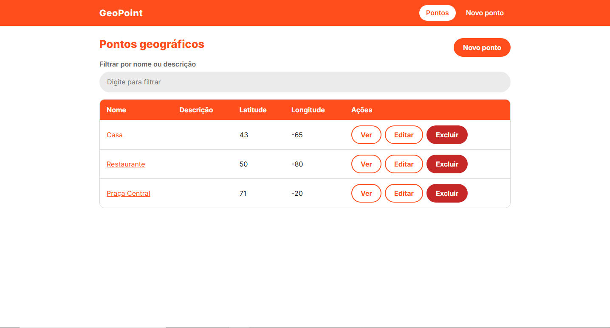
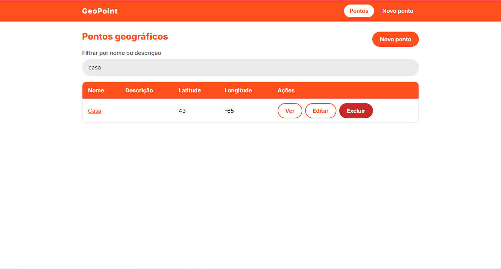
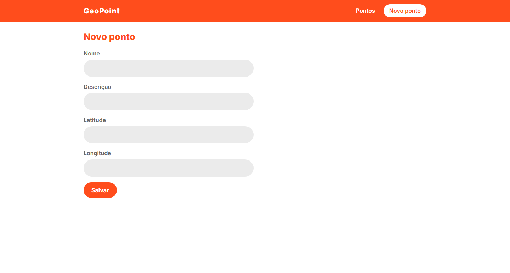
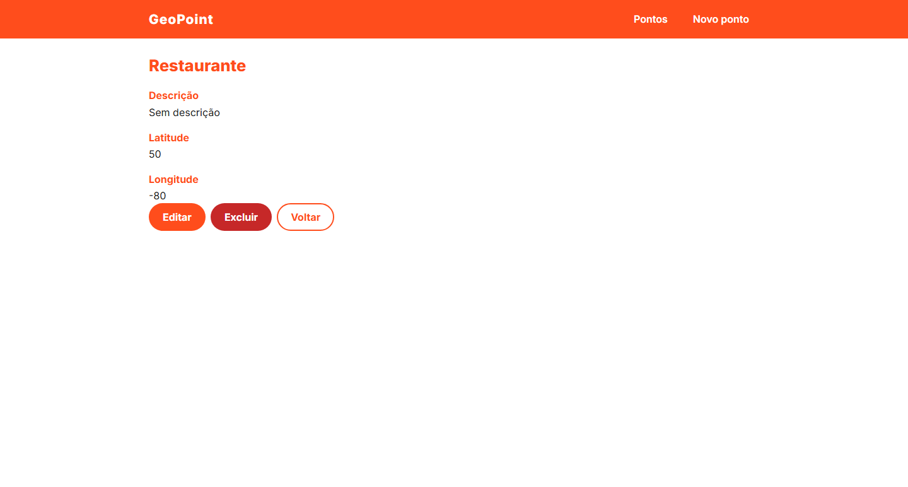
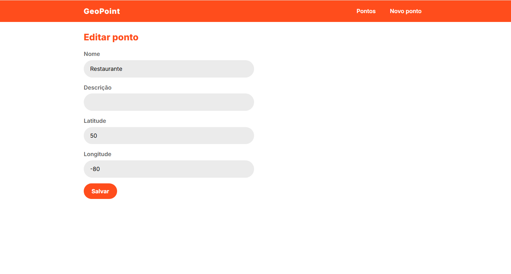

# GeoPoint - CRUD de Pontos Geográficos

**Aluno(s):** SEU NOME
**Disciplina:** Desenvolvimento Frontend - Trabalho G2
**Tecnologia:** React (Vite + React Router)

## Sobre o projeto
Frontend de um CRUD (cadastrar, listar, editar e excluir) de pontos geográficos, consumindo a GeoPoint API.

## API utilizada
`http://localhost:8080/api/points`

A API usada é uma API de apoio, feita em Node.js + Express. Os dados ficam gravados em `pontos.json`.

## Como rodar

### 1. API
```bash
cd geopoint-api
npm install
node server.js
```

### 2. Frontend (em outro terminal)
```bash
cd geopoint-frontend
npm install
npm run dev
```

Abra o endereço mostrado pelo Vite (`http://localhost:5173`).

## Telas

### Listagem


### Filtro


### Cadastro


### Detalhe


### Edição
